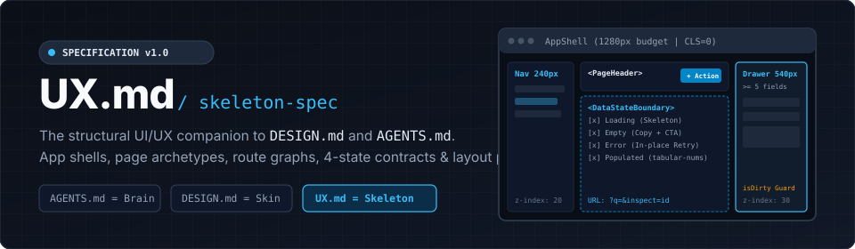

# UX.md

<p align="center">
  
</p>

<p align="center">
  <a href="docs/spec.md"></a>
  <a href="skills/ux-md-generator/SKILL.md"></a>
  <a href="LICENSE"></a>
</p>

A format specification, zero-dependency linter, and installable AI agent skill for describing **structural UI/UX architecture** (`UX.md`).

While **`AGENTS.md`** defines engineering rules and **`DESIGN.md`** defines visual tokens (the skin), **`UX.md`** defines the **skeleton and behavioral nervous system** of an application: app shells, viewport budget math, scroll and z-index ownership, page archetypes, route reachability graphs, URL state persistence, 4-state view contracts, and mandatory layout primitives.

---

## Why `UX.md` Exists (Skin vs. Skeleton)

Giving an AI coding agent a `DESIGN.md` ensures every screen uses the right colors, fonts, and border radii. Yet across multi-session prompts, the interface still fractures into a "Frankenstein UI":

- **Session 1** builds `/issues` with a `1280px` container, places `+ New Issue` in the top-right header, edits items in a right-hand slide-over drawer, and renders a geometry-matched skeleton loader.
- **Session 2** builds `/cycles` with an `896px` container, places the creation button underneath the table, opens a centered modal for an 8-field form, and renders plain `"Loading..."` text.
- **Session 3** forgets empty and error states, stores active filters in local `useState` (so pressing `F5` or Browser `Back` wipes the screen), and renders an `"Export"` button wired to `onClick={() => {}}`.

| File Standard | Metaphor | What It Governs |
| :--- | :--- | :--- |
| **`AGENTS.md`** | **Brain & Governance** | Module boundaries, build/test commands, dependency rules, security constraints |
| **`DESIGN.md`** | **Skin & Visual Tokens** | Color palette, typography scale, border radii, shadows, spacing units, motion curves |
| **`UX.md`** | **Skeleton & Behavior** | App shell geometry, page archetypes, route graph, modal vs. drawer thresholds, 4-state view matrix (`Loading / Empty / Error / Populated`), URL state persistence, and code layout primitives |

---

## Quickstart

### 1. Install the Agent Skill (`ux-md-generator`)

Works with **Claude Code**, **Antigravity / Gemini CLI**, **Cursor**, **OpenCode**, **OpenAI Codex**, and **GitHub Copilot**:

```bash
npx skills add SolidStateNetwork/ux.md --skill ux-md-generator --copy -y
```

### 2. Generate, Extract, or Audit a `UX.md`

Prompt your coding agent in any of the 4 supported operating modes:

- **Mode A — Synthesize (Greenfield / `init`):**
  > *"Use `ux-md-generator` to generate a `UX.md` for our Next.js B2B billing workspace aligned with `.ai/01-architecture.md` and `DESIGN.md`."*
- **Mode B — Extract from Reference Product:**
  > *"Use `ux-md-generator` to create a `UX.md` modeled after Linear's keyboard-first workspace and slide-over inspector drawer."*
- **Mode C — Audit & Reverse-Engineer Existing Code:**
  > *"Run `ux-md-generator` in audit mode across `src/app/` to unify our container widths, modal/drawer thresholds, and missing empty/error states into `UX.md`."*
- **Mode D — Evolve on New Routes:**
  > *"Add the `/settings/webhooks` route to `UX.md` and validate it before implementing the page."*

### 3. Validate Any `UX.md` with the Linter

```bash
node .agents/skills/ux-md-generator/scripts/validate-ux.mjs UX.md --strict
```

Output as structured JSON for CI or agent self-verification:

```bash
node .agents/skills/ux-md-generator/scripts/validate-ux.mjs UX.md --json
```

---

## The `UX.md` v1 Format (Hybrid YAML + 12 Canonical Sections)

Inspired by [Google's `DESIGN.md` specification](https://github.com/google-labs-code/design.md), `UX.md` pairs **machine-verifiable YAML frontmatter** with **12 deterministic Markdown sections** (see [`docs/spec.md`](docs/spec.md) and [`PHILOSOPHY.md`](PHILOSOPHY.md)):

```yaml
---
spec_version: "1.0"
project: "Acme Workspace"
platform_profile: "web-app"          # web-app | mobile-native | desktop-app | terminal-tui
archetype: "b2b-saas-workspace"      # b2b-saas-workspace | ai-chat-canvas | analytics-dashboard | ecommerce-storefront
token_source: "DESIGN.md"
scroll_owner: "inner-canvas"         # window | inner-canvas | split-pane
breakpoints:
  mobile_max: 767
  tablet_max: 1023
  desktop_min: 1280
shell_budget:
  desktop_viewport: 1280
  left_nav_px: 240
  right_panel_px: 0
  outer_padding_px: 48
  content_min_px: 720
  collapse_priority:
    - panel: "left_nav"
      below_px: 1024
z_index_scale:
  base: 0
  sticky: 10
  navigation: 20
  drawer: 30
  modal: 40
  popover: 50
  toast: 60
  tooltip: 70
thresholds:
  modal_max_fields: 4
  no_spinner_below_ms: 150
  skeleton_min_ms: 150
  toast_auto_dismiss_ms: 4000
  min_touch_target_px: 44
layout_primitives:
  - "AppShell"
  - "PageHeader"
  - "PageSection"
  - "DataStateBoundary"
---
```

| Section | Enforced Contract |
| :--- | :--- |
| **`0. Product & Domain Topology`** | Core user loop, auth/RBAC boundary, and input modality aligned with system architecture |
| **`1. Spatial Architecture & App Shell`** | ASCII app-shell wireframe, zone dimensions (`px`), and verified Viewport Budget math at `1280px` / `768px` / `375px` |
| **`2. Scroll, Viewport & Z-Index Contract`** | Single scroll owner (prevents double scrollbars), sticky regions, `CLS = 0` reservations, and monotonic Z-Index table |
| **`3. Core Page Archetypes (Blueprints)`** | 3–5 named screen templates (`### Archetype: <ID>`) with ASCII wireframes and fixed Primary CTA coordinates |
| **`4. Navigation, Route Graph & URL Persistence`** | Mermaid `flowchart LR` route map, bi-directional Route Reachability Table, and the F5 / Back-button URL State Persistence Matrix |
| **`5. Overlay & Feedback Decision Matrix`** | Hard numeric thresholds separating `Modal` (`<= 4` fields), `Drawer` (`5–12` fields / inspect), `Dedicated Route` (`> 12` fields), `Popover`, and `Toast` |
| **`6. Mandatory View States (4-State Matrix)`** | Every view mapped across `Loading (Skeleton)`, `Empty (Copy + CTA)`, `Error (Reason + In-Place Retry)`, and `Populated` |
| **`7. Mutation, Form & Permission Ergonomics`** | Validation timing, double-submit locking, `isDirty` backdrop/`Esc` guard, 2-tier destructive rules (`Undo Toast` vs. `Confirm Modal`), and 3-way permission gates (`Hide` vs. `Disable + Tooltip` vs. `Lock Badge`) |
| **`8. Real-Data Stress, Density & Truncation`** | Single collection scaling strategy, `min-w-0 truncate` / `line-clamp`, `—` null fallback, and right-aligned `tabular-nums` |
| **`9. Responsive Reflow & Input Choreography`** | Breakpoint collapse sequence, table-to-card conversion below `768px`, keyboard shortcuts (`Cmd+K`, `Esc`), and focus trapping |
| **`10. Mandatory Layout Primitives (Code Contract)`** | Shared code wrappers (`<AppShell>`, `<PageHeader>`, `<PageSection>`, `<DataStateBoundary>`) required across all route files |
| **`11. Project Do's, Don'ts & Agent Prompt Guide`** | Counter-intuitive negative constraints with measurable numbers + pre-commit verification checklist |

---

## Automated Linter Rules (`validate-ux.mjs`)

The bundled linter checks both mathematical invariants and cross-section referential integrity:

| Rule ID | Severity | What It Verifies |
| :--- | :--- | :--- |
| `missing-frontmatter` | `error` | Required YAML frontmatter keys (`spec_version`, `shell_budget`, `z_index_scale`, `thresholds`, `layout_primitives`) |
| `missing-sections` | `error` | All 12 canonical sections (`## 0.` through `## 11.`) exist |
| `section-order` | `warning` | Sections appear in canonical order `0` through `11` |
| `viewport-overflow` | `error` | `left_nav_px + right_panel_px + outer_padding_px + content_min_px <= desktop_viewport` (or valid `collapse_priority`) |
| `z-index-collision` | `error` | Strictly ascending scale (`base < sticky < navigation < drawer < modal < popover < toast < tooltip`) |
| `broken-route-ref` | `error` | Every route in Section 4 references an `<ArchetypeID>` defined in Section 3 |
| `orphaned-archetype` | `warning` | Flags any Page Archetype defined in Section 3 that is never used by a route in Section 4 |
| `dead-end-flow` | `error` | Flags routes missing an `Entry Trigger`, `Primary Action`, or `Exit / Cancel Fallback` |
| `incomplete-state-matrix` | `error` | Verifies Section 6 defines all 4 mandatory states (`Loading`, `Empty`, `Error`, `Populated`) per view |
| `vague-prose` | `warning` | Flags non-deterministic adjectives (*"modals for small forms"*, *"clean layout"*) and unresolved `TODO`/`TBD` markers |
| `design-md-mismatch` | `warning` | Verifies `token_source: "DESIGN.md"` alignment when a sibling `DESIGN.md` is present |

---

## Gold-Standard Examples

| Example | Archetype | Highlights |
| :--- | :--- | :--- |
| [`examples/b2b-saas-workspace/UX.md`](examples/b2b-saas-workspace/UX.md) | `b2b-saas-workspace` | Linear-inspired keyboard-first issue workspace with `240px` rail, `?inspect=` slide-over drawer (`540px`), and `Cmd+K` palette |
| [`examples/ai-chat-canvas/UX.md`](examples/ai-chat-canvas/UX.md) | `ai-chat-canvas` | Split-pane conversational thread + synchronized Artifact code/preview stage (`?artifact=`) with streaming scroll-lock rules |

---

## Repository Structure

```text
ux.md/
├── README.md                                  # Overview, Triad positioning & Quickstart
├── PHILOSOPHY.md                              # Design rationale: Thresholds over Adjectives & Skin vs. Skeleton
├── docs/
│   └── spec.md                                # Formal UX.md v1 specification & linter rule definitions
├── examples/
│   ├── b2b-saas-workspace/UX.md               # Verified B2B SaaS Workspace reference specification
│   └── ai-chat-canvas/UX.md                   # Verified AI Chat + Artifact Canvas reference specification
└── skills/
    └── ux-md-generator/                       # Installable via: npx skills add SolidStateNetwork/ux.md --skill ux-md-generator
        ├── SKILL.md                           # 4-mode, 3-phase generation & audit pipeline
        ├── resources/
        │   ├── ux-md-format.md                # Section-by-section template & schema rules
        │   ├── archetype-taxonomy.md          # Platform profiles (Web, Mobile, Desktop, TUI) & product archetypes
        │   ├── layout-primitives.md           # Code contracts for <AppShell>, <PageHeader>, <PageSection>, <DataStateBoundary>
        │   ├── anti-patterns.md               # AP-01 to AP-10 structural anti-pattern catalog
        │   ├── quality-checklist.md           # [UX-01] to [UX-16] cross-audit checklist
        │   └── writing-style-guide.md         # Banned vague terms & required units
        └── scripts/
            └── validate-ux.mjs                # Zero-dependency Node.js linter (--strict, --json)
```

---

## License

MIT © [SolidStateNetwork](https://github.com/SolidStateNetwork)
