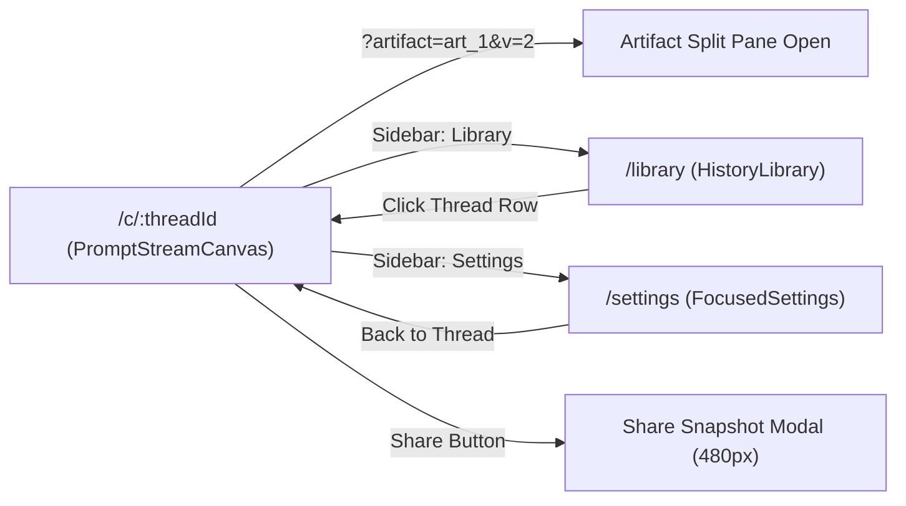

# UX.md — AI Chat & Artifact Split-Canvas Workspace

## 0. Product & Domain Topology
- **Core Value Loop:** Users converse with an AI assistant in a streaming thread while inspecting, editing, and exporting generated code/document artifacts in a synchronized side-by-side canvas pane (`?artifact=<id>`).
- **Auth & Role Boundary:** Single-User Authenticated Workspace with shareable read-only public snapshot links (`/share/:snapshotId`).
- **Platform Profile:** `web-app` (`split-pane` desktop choreography collapsing to tab-switched panes below `1024px`).

## 1. Spatial Architecture & App Shell

```text
+-----------------------------------------------------------------------------------+
| [Thread Rail: 260px] | [Chat Stream Pane: min 420px] | [Artifact Canvas: 520px+]  |
|                      | [Sticky Header: 48px]         | [Artifact Toolbar: 48px]   |
| [+ New Thread]       +-------------------------------+----------------------------+
| - Search Threads     |                               |                            |
| - Today              |  Independent Scroll Pane A    |  Independent Scroll Pane B |
|   * API Refactor     |  (Message Stream, max 768px)  |  (Code / Preview / Diff)   |
|   * SQL Schema       |                               |                            |
|                      | [Sticky Prompt Box: bottom]   | [Version Slider + Export]  |
+-----------------------------------------------------------------------------------+
```

| Breakpoint | Fixed Chrome (`px`) | Outer Padding (`px`) | Available Content Width (`px`) | Collapse Action |
| :--- | :--- | :--- | :--- | :--- |
| `>= 1280px` (Desktop) | `260px` (Rail) + `520px` (Artifact) | `32px` | `468px` Chat (`>= 420px` min) | When Artifact Canvas opens, Thread Rail auto-collapses to `0px` below `1280px` to preserve split-pane budget. |
| `1024px – 1279px` (Small Laptop) | `0px` (Rail in overlay) + `520px` (Artifact) | `32px` | `472px – 727px` Chat | Thread Rail collapses into off-canvas drawer (`260px`); Chat + Artifact remain side-by-side. |
| `<= 1023px` (Tablet & Mobile) | `0px` | `24px` | Full single pane | Artifact Canvas converts into a full-screen Bottom Sheet / Segmented Tab (`[Chat] | [Artifact (1)]`). |

## 2. Scroll, Viewport & Z-Index Contract
- **Scroll Ownership:** `split-pane` — The outer shell is locked (`h-dvh overflow-hidden`); the Message Stream Pane and the Artifact Canvas Pane each own one independent vertical scroll container.
- **Auto-Scroll & Scroll-Lock Break:** During token streaming, the Message Stream auto-scrolls to the bottom ONLY while the user is within `48px` of the bottom edge. Any upward wheel/touch scroll immediately disengages auto-scroll and reveals a floating `[Jump to Bottom]` pill at `z-index: 10`.
- **CLS Protection:** Artifact pill cards inside the chat stream reserve a fixed `64px` height so opening or streaming an artifact never shifts message history.

| Layer Name | Z-Index | Assigned Components |
| :--- | :--- | :--- |
| `base` | `0` | Message bubbles, code blocks, artifact canvas body |
| `sticky` | `10` | Top pane headers (`48px`), bottom prompt composer, `[Jump to Bottom]` floating pill |
| `navigation` | `20` | Left Thread Rail (`260px`), system degradation banner |
| `drawer` | `30` | Off-canvas Thread Rail sheet (`< 1280px`), mobile Artifact Bottom Sheet (`< 1024px`) |
| `modal` | `40` | Share Snapshot Modal (`480px`), Delete Thread Confirmation Modal (`480px`) |
| `popover` | `50` | Model selector dropdown, attachment menu, artifact version picker |
| `toast` | `60` | Clipboard copy and snapshot link confirmation toasts (`4000ms`) |
| `tooltip` | `70` | Token usage, latency metrics, and icon button tooltips |

## 3. Core Page Archetypes (Blueprints)

### Archetype: PromptStreamCanvas
- **Purpose & Max-Width:** Dual-pane conversational workspace (`max-w: 768px` centered message column when artifact closed; `flex-1` split when artifact open).
- **Primary CTA Position:** Sticky bottom prompt composer `Send / Stop Generation` button (`Enter` to send, `Shift+Enter` for newline, `Esc` to abort active stream).
```text
+----------------------------------------+------------------------------------+
| Model: Claude 3.7  [Share]             | Artifact: schema.sql [Code|Preview]|
+----------------------------------------+------------------------------------+
| User: Generate normalized billing SQL  | 1 | CREATE TABLE invoices (        |
| Assistant: Here is the schema...       | 2 |   id UUID PRIMARY KEY,         |
| [Artifact Card: schema.sql v2 ->]      | 3 |   amount_cents INTEGER         |
| [Prompt Composer...           [Send]]  | [v1 | v2 (latest)]     [Copy Code] |
+----------------------------------------+------------------------------------+
```

### Archetype: HistoryLibrary
- **Purpose & Max-Width:** Searchable archive of past threads and generated artifacts (`max-w: 1024px`).
- **Primary CTA Position:** Top-right slot of `<PageHeader>` (`+ New Thread`).
```text
+--------------------------------------------------------------------+
| Thread & Artifact Library                          [+ New Thread]  |
+--------------------------------------------------------------------+
| [Search q=...] [Type: All | Threads | Artifacts]                   |
+--------------------------------------------------------------------+
| Title                           | Last Artifact   | Updated        |
| Billing SQL & Stripe Webhooks   | schema.sql (v2) | 18m ago        |
+--------------------------------------------------------------------+
```

### Archetype: FocusedSettings
- **Purpose & Max-Width:** Single-column custom instructions, API keys, and memory controls (`max-w: 640px`).
- **Primary CTA Position:** Sticky bottom-right action bar (`Save Preferences`).
```text
+--------------------------------------------------+
| Workspace Settings / Custom Instructions         |
+--------------------------------------------------+
| [Textarea: System instructions & coding rules  ] |
| [Toggle: Persist conversation memory           ] |
+--------------------------------------------------+
|                         [Discard] [Save Changes] |
+--------------------------------------------------+
```

## 4. Navigation, Route Graph & URL Persistence



| Route | Archetype | Entry Trigger | Primary Action | Exit / Cancel Fallback |
| :--- | :--- | :--- | :--- | :--- |
| `/c/:threadId` | `PromptStreamCanvas` | Thread Rail click, `+ New Thread`, or `/library` row | Submit prompt or inspect artifact (`?artifact=`) | Collapse artifact (`Esc`) or switch thread in rail |
| `/library` | `HistoryLibrary` | Thread Rail `Library` link or `Cmd+Shift+L` | Filter and open thread or artifact | Return to active `/c/:threadId` |
| `/settings` | `FocusedSettings` | User menu `Settings` or `Cmd+,` | Save custom instructions / keys | Discard unsaved changes and return to `/c/:threadId` |
| `/share/:snapshotId` | `PromptStreamCanvas` | External public deep link | Fork thread into own workspace (`[Fork Thread]`) | Navigate to `/library` |

### State Persistence Matrix (F5 & Back-Button Contract)

| State Category | Storage Location | Parameter / Key Example | Reset Trigger |
| :--- | :--- | :--- | :--- |
| Active Artifact & Version | `URL Query` | `?artifact=art_1&v=2&tab=preview` | Closing artifact pane removes query params |
| Library Search & Filter | `URL Query` | `?q=stripe&type=artifacts` | Clicking `Reset Filters` |
| Unsent Prompt Composer Text | `LocalStorage` | `ux.draft_prompt.<threadId>` | Cleared immediately upon successful message send |
| Thread Rail Open/Closed | `LocalStorage` | `ux.rail_collapsed` | User toggle or viewport `< 1280px` auto-collapse |
| Active Token Stream Buffer | `Ephemeral Memory` | Streaming controller state | Stream completion or user pressing `Stop` |

## 5. Overlay & Feedback Decision Matrix

| Pattern | Trigger Condition & Field Limit | Dimensions | Dismiss & Dirty-State Behavior |
| :--- | :--- | :--- | :--- |
| `Artifact Split Pane` | Inspecting or editing code/document output (`> 15 lines`) alongside chat | `width: 520px – 55%` on desktop; `92vh` Bottom Sheet `< 1024px` | Closing removes `?artifact=` URL param; prompts if manual code edits are unsaved (`isDirty`) |
| `Centered Modal` | Creating public share link or Tier-2 thread deletion (`<= 4` fields) | `max-w: 480px` | `Esc` or backdrop click closes when `isDirty === false` |
| `Popover Menu` | Switching AI model, temperature, or uploading file attachments | `width: 260px`, `max-h: 340px` | Closes on selection, `Esc`, or outside click |
| `Inline Checkmark` | Copying code block or message markdown to clipboard | Inline inside button (`2000ms` duration) | Replaces copy icon with checkmark for `2000ms` (never fires a toast for code copy) |
| `Auto-Dismiss Toast` | Thread archived with `[Undo]` or public snapshot link generated | `width: 340px`, bottom-right | Auto-dismisses after `4000ms` |

## 6. Mandatory View States (4-State Matrix)

| View / Component | `Loading` (Skeleton Geometry) | `Empty` (Copy + Primary CTA) | `Error` (Message + Retry Action) | `Populated` (Density & Overflow) |
| :--- | :--- | :--- | :--- | :--- |
| `/c/:threadId` (`PromptStreamCanvas`) | **Initial Load:** 3 alternating message skeletons (`72px` and `140px`). **Streaming State:** Live token append + pulsing cursor + `[Stop Generating]` button | Centered starter stage (`max-w: 640px`): greeting + 3 clickable starter prompt cards + focused composer | Inline assistant error bubble preserving partial streamed output + `[Regenerate Response]` button (user prompt is never lost) | `768px` max message measure (`65ch`), sticky code block headers, `64px` artifact trigger cards |
| `/library` (`HistoryLibrary`) | 8 row skeletons (`56px` height) matching title, artifact badge, and timestamp columns (`CLS = 0`) | Centered `420px` container: *"No threads or artifacts found."* + `[+ Start New Thread]` CTA | Inline error card with `[Retry Load]` button | Cursor-paginated list (`25 rows/page`), title `truncate` at `52 chars` |
| `/settings` (`FocusedSettings`) | 3 form card skeletons (`120px` height each) inside `640px` column | Custom instructions textarea shows concrete placeholder example | Persistent inline banner above form + field-level error message | Auto-expanding textarea (`min-h: 140px`, `max-h: 420px`) with character counter |

## 7. Mutation, Form & Permission Ergonomics
- **Prompt Submission & Streaming Lock:** Pressing `Enter` immediately appends the user message to the stream, saves a backup draft until ACKed, and transforms the `Send` button into a `[Stop]` button (`Esc` or click aborts stream without deleting partial tokens).
- **Dirty-State Guard (`isDirty`):** Unsent prompt text is auto-persisted per thread in `localStorage` (`ux.draft_prompt.<threadId>`). In `/settings` or manual Artifact code edits, `isDirty === true` blocks navigation and backdrop close until confirmed.
- **Destructive Action Tiers:**
  - **Tier 1 (Archive Thread):** Instant optimistic removal from Thread Rail + `4000ms` Toast with `[Undo]`.
  - **Tier 2 (Delete Thread Permanently / Revoke Share Link):** `480px` Confirmation Modal stating that associated artifacts and public snapshot links will stop working immediately.
- **Permission & Entitlement Gates:**
  - **Read-Only Snapshot (`/share/:snapshotId`):** Hide Settings/Rail navigation; replace bottom prompt composer with a sticky `[Fork Thread to Continue Chatting]` CTA bar.
  - **Prerequisite-Restricted (Empty prompt or file still uploading):** Render `Send` button `disabled` with tooltip (*"Wait for attachment upload to finish"*).
  - **Plan-Restricted (Pro Reasoning Model):** Show model in selector with `Pro` lock badge; selecting opens an inline upgrade popover.

## 8. Real-Data Stress, Density & Truncation
- **Collection Scaling:** Thread Rail loads top `30` recent threads with virtualized scroll on expansion; `/library` uses cursor pagination (`25 items/page`).
- **Text & Code Overflow Rules:** Thread titles in the `260px` rail enforce `min-w-0 truncate` (1 line). Code blocks inside chat messages never wrap by default (`overflow-x-auto`) and cap vertical height at `420px` before collapsing into an Artifact card.
- **Missing / Null Data Fallback:** Threads without an artifact render `—` in the `/library` artifact column.
- **Numeric & Temporal Alignment:** Token counts, latency (`ms`), version numbers (`v1`, `v2`), and timestamps enforce `tabular-nums`.

## 9. Responsive Reflow & Input Choreography
- **Breakpoint Collapse Sequence:**
  1. `< 1280px`: Opening the right Artifact Canvas automatically collapses the left `260px` Thread Rail so Chat (`>= 420px`) and Artifact (`520px`) never crush each other.
  2. `< 1024px`: Side-by-side split pane collapses into a single active viewport with a top segmented toggle (`[Chat] | [Artifact]`) or slide-up Bottom Sheet (`92vh`).
  3. `< 768px`: Prompt composer docks to `env(safe-area-inset-bottom)` with automatic visual-viewport keyboard avoidance; all touch targets enforce `>= 44x44px`.
- **Keyboard & Focus Choreography:**
  - `/` or `Cmd+J` focuses the prompt composer from anywhere; `Esc` stops active generation or closes the Artifact pane.

## 10. Mandatory Layout Primitives (Code Contract)

| Primitive | Required Usage | Forbidden Bypass |
| :--- | :--- | :--- |
| `<AppShell>` | Manages the 3-pane responsive choreography (`ThreadRail`, `PrimaryPane`, `ArtifactCanvas`) and `h-dvh` lock. | Manually nesting `100vh` flex containers or ad-hoc split panes inside route components. |
| `<PageHeader>` | Fixed `48px` top bar for each pane (Model/Thread selector on left, Share/Artifact controls on right). | Inconsistent header heights between Chat pane and Artifact pane. |
| `<PageSection>` | Enforces `max-w: 768px` for reading/chat streams, `max-w: 1024px` for `/library`, and `max-w: 640px` for `/settings`. | Full-width unconstrained prose lines (`> 80ch`) stretching across wide monitors. |
| `<DataStateBoundary>` | Wraps thread history, library tables, and artifact preview compilation states. | Dropping user prompts on network error or rendering raw JSON errors without `[Regenerate]`. |

## 11. Project Do's, Don'ts & Agent Prompt Guide

### Do's & Don'ts (Counter-Intuitive Threshold Rules)
- **DO** auto-collapse the `260px` left Thread Rail whenever the `520px` Artifact Canvas opens on viewports `< 1280px`.
- **DO** disengage chat auto-scroll immediately if the user scrolls up by more than `48px` during token streaming, and show a `[Jump to Bottom]` button.
- **DO** preserve both the user's submitted prompt and any partially streamed tokens when a network or LLM error occurs, offering an inline `[Regenerate]` button.
- **DO** synchronize the open artifact ID and version (`?artifact=art_1&v=2`) in the URL query string.
- **DO** use a `2000ms` inline checkmark icon inside the `Copy Code` button instead of firing a toast notification.
- **DON'T** clear the prompt composer input before the message is safely committed to the local thread state.
- **DON'T** render side-by-side split panes below `1024px` viewport width.
- **DON'T** allow long code blocks (`> 30 lines`) to bloat the main chat column when Artifact mode is enabled — extract them into the Artifact Canvas and render a `64px` trigger card.
- **DON'T** auto-dismiss stream or API error messages.
- **DON'T** allow `Esc` or backdrop clicks to discard unsaved manual edits inside the Artifact code editor (`isDirty === true`).

### Pre-Commit Agent Checklist
1. Does the view use `<AppShell>`, `<PageHeader>`, `<PageSection>`, and `<DataStateBoundary>`?
2. Does opening the Artifact Canvas keep both Chat (`>= 420px`) and Artifact (`>= 520px`) within the `1280px` viewport budget?
3. Are `Loading / Streaming`, `Empty`, `Error (with partial token retention)`, and `Populated` states handled?
4. Do `?artifact=<id>&v=<version>` URL parameters survive `F5` refresh and Browser `Back`?
5. Does `node .agents/skills/ux-md-generator/scripts/validate-ux.mjs UX.md` pass with `0 errors`?
