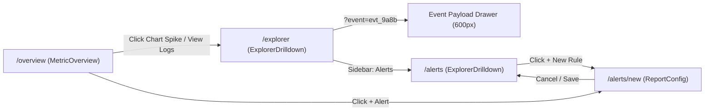

# UX.md: Stripe-Style Telemetry & Revenue Analytics Dashboard

## 0. Product & Domain Topology
- **Core value loop:** Operators filter global time ranges and environments in a persistent sticky toolbar (`?from=&to=&env=`), inspect time-series anomalies across KPI cards and charts, and drill into raw event payloads inside a slide-over inspector drawer (`?event=<id>`).
- **Auth and role boundary:** Multi-Tenant RBAC (`Admin`, `Analyst`, `BillingReadOnly`).
- **Platform profile:** `web-app` (`Pointer + Keyboard First` with URL-persisted query state across all routes).

## 1. Spatial Architecture & App Shell

```text
+-----------------------------------------------------------------------------------+
| [Left Nav: 220px]    | [Sticky PageHeader: 48px (Title + Export / Alert CTA)]     |
|                      +------------------------------------------------------------+
| - Environment Pill   | [Sticky Global Time & Dimension Filter Bar: 48px]          |
| - Overview           +------------------------------------------------------------+
| - Event Explorer     |  Main Scrollable Canvas (scroll_owner: inner-canvas)       |
| - Cohorts & Funnels  |  Padding: 24px Left / 24px Right (48px total outer)        |
| - Alerts & Webhooks  |  Content Min-Width: 760px | Max-Width: 1280px              |
|                      |  - KPI Strip (4 cards, 104px fixed height)                 |
| [Footer: UTC Clock]  |  - Primary Time-Series Chart (320px fixed height)          |
+-----------------------------------------------------------------------------------+
```

| Breakpoint | Fixed Chrome (`px`) | Outer Padding (`px`) | Available Content Width (`px`) | Collapse Action |
| :--- | :--- | :--- | :--- | :--- |
| `>= 1280px` (Desktop) | `220px` (Left Nav) | `48px` (`24px` x 2) | `1012px` (`>= 760px` min) | Persistent left rail; 4-column KPI grid; Event Inspector opens as `600px` right overlay drawer. |
| `768px to 1023px` (Tablet) | `0px` (Nav collapsed) | `32px` (`16px` x 2) | `736px to 991px` | Left Nav folds into `260px` off-canvas sheet via labeled `Menu` button; KPI grid wraps to 2x2. |
| `<= 767px` (Mobile) | `0px` (Bottom Bar `56px`) | `24px` (`12px` x 2) | `351px to 743px` | KPI grid stacks to 1 column; Global Filter Bar collapses into a `[Time: 24h | Env: Prod]` summary trigger opening a filter Bottom Sheet. |

## 2. Scroll, Viewport & Z-Index Contract
- **Scroll ownership:** `inner-canvas` owns the single vertical scrollbar. Charts and log tables never create nested vertical page scrollbars.
- **Sticky regions:** `<PageHeader>` (`48px`) and the Global Time/Environment Filter Bar (`48px`) remain pinned at the top of `inner-canvas` (`z-index: 10`).
- **CLS protection:** KPI summary cards reserve `104px` height, primary charts reserve `320px` height, and log table rows reserve `36px` height per row before data resolves.

| Layer Name | Z-Index | Assigned Components |
| :--- | :--- | :--- |
| `base` | `0` | KPI cards, SVG/Canvas charts, breakdown tables |
| `sticky` | `10` | `<PageHeader>`, sticky global time-range bar, sticky table header |
| `navigation` | `20` | Fixed left navigation rail (`220px`), mobile bottom navigation bar (`56px`) |
| `drawer` | `30` | Event payload inspector drawer (`600px`), mobile filter bottom sheet |
| `modal` | `40` | Scheduled report modal (`480px`), Tier-2 alert deletion confirmation modal (`480px`) |
| `popover` | `50` | Custom date-range calendar popover, dimension facet combobox |
| `toast` | `60` | CSV export ready and alert mute undo toasts (`4000ms`) |
| `tooltip` | `70` | Chart crosshair scrub tooltips and metric formula definitions |

## 3. Core Page Archetypes (Blueprints)

### Archetype: MetricOverview
- **Purpose and max-width:** Executive and operational telemetry dashboard (`max-w: 1280px`).
- **Primary CTA position:** Top-right slot of `<PageHeader>` (`+ Create Alert` or `Export CSV`).
```text
+--------------------------------------------------------------------+
| Telemetry Overview                        [Export CSV] [+ Alert]   |
+--------------------------------------------------------------------+
| [Env: Production] [Range: Last 7d] [Compare: Previous Period]      |
+----------------+----------------+----------------+-----------------+
| Net Volume     | Success Rate   | P95 Latency    | Failed Events   |
| $142,890 (+4%) | 99.94% (+0.1%) | 184ms (-12ms)  | 28 (-19%)       |
+----------------+----------------+----------------+-----------------+
| Primary Time-Series Chart (320px height, synchronized crosshair)   |
+--------------------------------------------------------------------+
```

### Archetype: ExplorerDrilldown
- **Purpose and max-width:** High-density event log and facet query explorer (`max-w: 1280px`, `36px` row height).
- **Primary CTA position:** Top-right slot of `<PageHeader>` (`Save View`).
```text
+--------------------------------------------------------------------+
| Event Explorer                                         [Save View] |
+--------------------------------------------------------------------+
| [Query: status>=400 AND path:/v1/charges]           142 events     |
+--------------------------------------------------------------------+
| Timestamp (UTC)      | Status | Endpoint      | Latency | Event ID |
| 2026-11-18 20:14:02  | 502    | /v1/charges   | 1,420ms | evt_9a8b |
+--------------------------------------------------------------------+
```

### Archetype: ReportConfig
- **Purpose and max-width:** Single-column threshold alert and webhook configuration form (`max-w: 640px`).
- **Primary CTA position:** Sticky bottom-right form action bar (`Save Alert Rule`).
```text
+--------------------------------------------------+
| Alerts & Webhooks / New Threshold Rule           |
+--------------------------------------------------+
| [Select Metric: P95 Latency                    ] |
| [Threshold: > 500 ms over 5 minute window      ] |
| [Destination: Slack #ops-alerts                ] |
+--------------------------------------------------+
|                        [Cancel] [Save Alert Rule]|
+--------------------------------------------------+
```

## 4. Navigation, Route Graph & URL Persistence



| Route | Archetype | Entry Trigger | Primary Action | Exit / Cancel Fallback |
| :--- | :--- | :--- | :--- | :--- |
| `/overview` | `MetricOverview` | Left Nav `Overview` link or root redirect | Scrub time-series charts or drill into `/explorer` | Switch environment or reset date range |
| `/explorer` | `ExplorerDrilldown` | Left Nav `Event Explorer` or chart data-point click | Filter event logs and inspect row payload (`?event=id`) | Return to `/overview` preserving `?from=&to=&env=` |
| `/alerts` | `ExplorerDrilldown` | Left Nav `Alerts & Webhooks` | Inspect active alert rules or navigate to `/alerts/new` | Return to `/overview` |
| `/alerts/new` | `ReportConfig` | `+ Alert` CTA in `<PageHeader>` | Save threshold rule and test webhook delivery | Discard draft and return to `/alerts` |

### State persistence matrix (`F5` and Back-button contract)

| State Category | Storage Location | Parameter / Key Example | Reset Trigger |
| :--- | :--- | :--- | :--- |
| Global Date Range & Environment | `URL Query` | `?env=prod&from=2026-11-11&to=2026-11-18&tz=UTC` | Selecting `Reset to Last 24h` in time picker |
| Explorer Facet Query & Cursor | `URL Query` | `?q=status%3A502&cursor=evt_9a8b` | Clicking `Clear query` button |
| Open Event Payload Drawer | `URL Query` | `?event=evt_9a8b&tab=headers` | Pressing `Esc` or close icon removes `?event` |
| Timezone Display Preference | `LocalStorage` | `ux.display_timezone` (`UTC` vs `Local`) | User toggle in footer clock pill |
| Chart Hover Crosshair Position | `Ephemeral Memory` | Synchronized pointer coordinate state | Pointer leaves chart bounding box |

## 5. Overlay & Feedback Decision Matrix

| Pattern | Trigger Condition & Field Limit | Dimensions | Dismiss & Dirty-State Behavior |
| :--- | :--- | :--- | :--- |
| `Slide-Over Drawer` | Inspecting raw JSON event payloads, headers, and stack traces (`?event=id`) | `width: 600px`, `100dvh` | `Esc` or close button removes `?event=` URL param; clicking another table row swaps drawer content in place |
| `Centered Modal` | Scheduling CSV email export or Tier-2 alert rule deletion (`<= 4` fields) | `max-w: 480px` | `Esc` or backdrop click closes when `isDirty === false` |
| `Dedicated Route` | Multi-condition alert builder or webhook endpoint form (`> 4` fields) | `max-w: 640px` (`ReportConfig`) | Prompts discard confirmation when `isDirty === true` |
| `Popover Calendar` | Selecting preset or custom UTC date/time intervals | `width: 520px` (dual month) | Applies range to URL query on `[Apply Range]` click or closes on `Esc` |
| `Auto-Dismiss Toast` | Background CSV generation started or alert rule muted (`[Undo]`) | `width: 360px`, bottom-right | Auto-dismisses after `4000ms` |

## 6. Mandatory View States (4-State Matrix)

| View / Component | `Loading` (Skeleton Geometry) | `Empty` (Copy + Primary CTA) | `Error` (Message + Retry Action) | `Populated` (Density & Overflow) |
| :--- | :--- | :--- | :--- | :--- |
| `/overview` (`MetricOverview`) | 4 KPI card skeletons (`104px` height) + `320px` chart shimmer frame (`CLS = 0`) | Zero-traffic banner inside chart frame: *"No events recorded for Production in the last 7 days."* + `[Expand to Last 30 Days]` or `[View SDK Setup Guide]` CTA | Inline chart error state with HTTP status + `[Retry Query]` button | 4-column KPI strip + synchronized SVG/Canvas charts with `tabular-nums` axes |
| `/explorer` (`ExplorerDrilldown`) | 12 shimmer table rows (`36px` height) matching timestamp, status, endpoint, latency, and ID columns | Centered `420px` block: *"0 events matched your filter query."* + `[Clear Query Filters]` CTA | Persistent query error banner above table (highlighting syntax error or timeout) + `[Run Query Again]` | `36px` monospace rows, `50 rows/page` cursor pagination, right-aligned latency (`ms`) |
| `/alerts` (`ExplorerDrilldown`) | 6 row skeletons (`48px` height) | Centered `420px` block: *"No alert rules configured."* + `[+ Create First Alert Rule]` CTA | Inline error card + `[Retry Load]` button | Status pill (`Firing`, `OK`, `Muted`), threshold summary, last triggered timestamp |
| `/alerts/new` (`ReportConfig`) | 4 form block skeletons (`72px` height) within `640px` width | Webhook destination dropdown shows `[+ Connect Slack or Webhook]` option | Persistent top validation banner + field-level message | Grouped fieldsets with live threshold preview sparkline |

## 7. Mutation, Form & Permission Ergonomics
- **Validation timing:** Validate query syntax in `/explorer` on `Enter` / `Run`; validate `/alerts/new` form fields on `blur` and `submit`, clearing errors immediately on edit.
- **Submit locking:** `[Save Alert Rule]` and `[Test Webhook]` lock (`disabled + aria-busy="true"`) during request flight while preserving button dimensions.
- **Dirty-state guard (`isDirty`):** Modifying alert thresholds in `/alerts/new` without saving intercepts router navigation and `Esc` with an explicit discard confirmation.
- **Destructive action tiers:**
  - **Tier 1 (mute alert rule for 1h):** Instant execution + `4000ms` Toast with `[Undo]`.
  - **Tier 2 (delete alert rule or revoke webhook signing secret):** `480px` Confirmation Modal detailing affected notification channels.
- **Permission and entitlement gates:**
  - **Role-restricted (`BillingReadOnly` vs `Admin`):** Hide `/alerts/new` and webhook mutation controls completely.
  - **Prerequisite-restricted (invalid time window `from > to`):** Disable `[Apply Range]` button in date popover with inline explanation (*"End time must be after start time"*).
  - **Plan-restricted (90-day historical retention):** Show `90d` preset with a `Lock` icon; selecting opens an inline retention upgrade popover.

## 8. Real-Data Stress, Density & Truncation
- **Collection scaling:** Cursor-based pagination (`50 rows/page`) in `/explorer` synced to `?cursor=`.
- **Text overflow rules:** Request paths and error messages in table rows enforce `min-w-0 truncate` (1 line); full payload and stack trace open in the `600px` Slide-Over Drawer on row click.
- **Missing or null data fallback:** Missing tags or optional response headers render `-` in muted monospace text. Never render `null`, `undefined`, or `NaN%`.
- **Numeric and temporal alignment:** All currency values, percentages, status codes, latencies (`ms`), and timestamps enforce `font-variant-numeric: tabular-nums`. Numeric columns align right; timestamps format consistently as `YYYY-MM-DD HH:mm:ss UTC`.

## 9. Responsive Reflow & Input Choreography
- **Breakpoint collapse sequence:**
  1. `< 1280px`: Event Payload Drawer (`600px`) overlays the table (`z-30`) rather than shrinking the table below `760px`.
  2. `< 1024px`: `220px` Left Nav collapses into an off-canvas sheet (`260px`) triggered by a labeled `Menu` button; 4-column KPI strip wraps to a 2x2 grid (`16px` gap).
  3. `< 768px`: KPI cards stack to 1 column; `/explorer` log rows collapse into 2-line stacked cards (`Row 1: Status Badge + Endpoint + Latency`, `Row 2: Timestamp + Event ID`); fixed bottom nav (`56px`) reserves `pb-14` + `env(safe-area-inset-bottom)` on `inner-canvas`.
- **Hover parity on touch:** Chart data points respond to touch-drag scrubbing with a persistent top metric readout bar so mobile users do not rely on cursor hover tooltips.
- **Keyboard and focus choreography:**
  - `/` focuses the event query bar; `J` / `K` moves through `/explorer` log rows while the `600px` Event Payload Drawer stays open and updates live; `Esc` closes the drawer and restores focus to the active row.

## 10. Mandatory Layout Primitives (Code Contract)

| Primitive | Required Usage | Forbidden Bypass |
| :--- | :--- | :--- |
| `<AppShell>` | Renders `220px` left rail, sticky global time-range bar, and `inner-canvas` scroll container. | Per-page scroll wrappers or omitting the global time-range filter context. |
| `<PageHeader>` | Renders route title, environment badge, and top-right primary CTA (`+ Alert`, `Save View`). | Placing export or alert buttons below charts or inside ad-hoc flex divs. |
| `<PageSection>` | Enforces `max-w: 1280px` (`MetricOverview`, `ExplorerDrilldown`) or `max-w: 640px` (`ReportConfig`). | Unconstrained full-bleed KPI grids or mixed container max-widths. |
| `<DataStateBoundary>` | Wraps each KPI strip, chart card, and log table with fixed-height skeletons (`104px` / `320px`). | Rendering collapsing `0px` loading spinners that cause chart layout shift (`CLS > 0`). |

## 11. Project Do's, Don'ts & Agent Prompt Guide

### Do's and Don'ts (threshold rules)
- **DO** persist `?env=`, `?from=`, `?to=`, and `?tz=` in the URL across every navigation link so switching from `/overview` to `/explorer` keeps the exact same time window.
- **DO** reserve `104px` height on KPI cards and `320px` height on chart containers during loading so `CLS` stays `0`.
- **DO** format every metric, percentage, latency, and timestamp with `tabular-nums` and right-align numeric table columns.
- **DO** allow `J` / `K` arrow navigation across `/explorer` rows while the `600px` Event Payload Drawer is open (`?event=id`).
- **DO** provide a touch-scrub readout header on charts below `768px` as the touch equivalent for hover crosshairs.
- **DON'T** render `NaN`, `Infinity%`, `null`, or `undefined` when a divisor is zero; render `-` instead.
- **DON'T** auto-dismiss query syntax errors or failed webhook test alerts.
- **DON'T** open raw JSON event payloads inside a centered Modal; always use the `600px` right Slide-Over Drawer so the log table context remains visible.
- **DON'T** trigger a loading spinner for cached time-range switches completing in `< 150ms`.
- **DON'T** allow horizontal page overflow on mobile tables below `768px`.

### Pre-commit agent checklist
1. Does the route compose `<AppShell>`, `<PageHeader>`, `<PageSection>`, and `<DataStateBoundary>`?
2. Do `?env=`, `?from=`, `?to=`, and `?event=` URL query parameters survive `F5` refresh and route transitions?
3. Are all numbers using `tabular-nums` and zero-division fallbacks (`-`)?
4. Do charts and KPI strips reserve fixed heights (`104px` / `320px`) in their loading skeletons?
5. Does `node .agents/skills/ux-md-generator/scripts/validate-ux.mjs UX.md` pass with `0 errors`?
