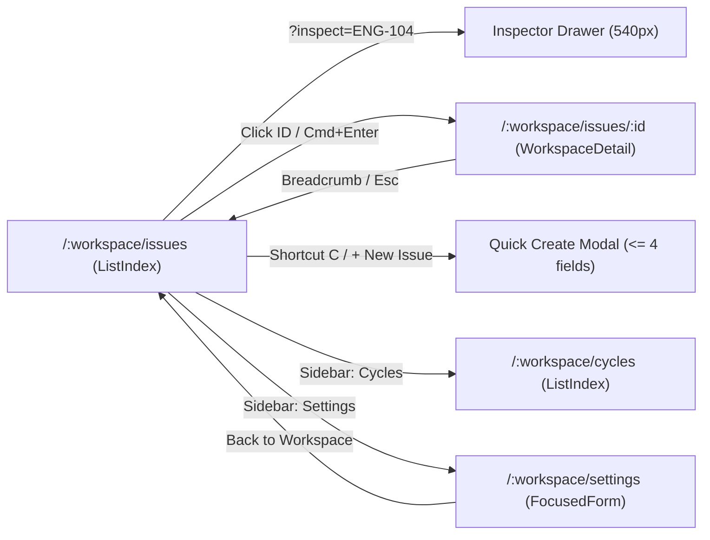

# UX.md — Linear-Style B2B Issue Workspace

## 0. Product & Domain Topology
- **Core Value Loop:** Engineers triage incoming issues in a keyboard-navigable list, inspect or mutate issue properties inside a non-blocking slide-over drawer (`?inspect=<id>`), and track cycle velocity.
- **Auth & Role Boundary:** Multi-Tenant RBAC (`Owner`, `Admin`, `Member`, `Viewer`). Workspace slug is scoped in the root route (`/:workspaceSlug/...`).
- **Platform Profile:** `web-app` (`Pointer + Keyboard First` with full `Cmd/Ctrl+K` command palette coverage).

## 1. Spatial Architecture & App Shell

```text
+-----------------------------------------------------------------------------------+
| [Sidebar: 240px Fixed] | [Sticky PageHeader: 48px Height (Breadcrumbs + Primary)] |
|                        +----------------------------------------------------------+
| - Workspace Switcher   | [Sticky Filter / Search Toolbar: 40px Height]            |
| - Cmd+K Search Trigger +----------------------------------------------------------+
| - My Issues            |                                                          |
| - Active Cycle         |  Main Scrollable Canvas (scroll_owner: inner-canvas)     |
| - Projects             |  Padding: 24px Left / 24px Right (48px total outer)      |
| - Views                |  Content Min-Width: 720px | Max-Width: 1280px            |
|                        |                                                          |
| [Footer: Sync + User]  |                                     [Drawer Slot: 540px] |
+-----------------------------------------------------------------------------------+
```

| Breakpoint | Fixed Chrome (`px`) | Outer Padding (`px`) | Available Content Width (`px`) | Collapse Action |
| :--- | :--- | :--- | :--- | :--- |
| `>= 1280px` (Desktop) | `240px` (Left Nav) | `48px` (`24px` x 2) | `992px` (`>= 720px` min) | Full persistent left rail; Inspector opens as `540px` right overlay drawer. |
| `768px – 1023px` (Tablet) | `0px` (Nav collapsed) | `32px` (`16px` x 2) | `736px – 991px` | Left Nav collapses into an off-canvas sheet (`260px`) triggered via topbar button or `[` shortcut. |
| `<= 767px` (Mobile) | `0px` (Bottom Bar `56px`) | `24px` (`12px` x 2) | `351px – 743px` | Left Nav moves to 4-item Bottom Bar + Sheet; Slide-Over Drawer becomes a `92vh` Bottom Sheet. |

## 2. Scroll, Viewport & Z-Index Contract
- **Scroll Ownership:** `inner-canvas` owns the single vertical scrollbar (`h-dvh overflow-hidden` on outer shell, `flex-1 overflow-y-auto` on main canvas). Nested full-height vertical scrollbars inside pages are prohibited.
- **Sticky Regions:** `<PageHeader>` (`48px`) and active filter bar (`40px`) stick to the top of `inner-canvas` at `z-index: 10`.
- **CLS Protection:** Every row list reserves `40px` per row during loading; metric header strips reserve `96px` height.

| Layer Name | Z-Index | Assigned Components |
| :--- | :--- | :--- |
| `base` | `0` | Standard canvas flow, tables, cards |
| `sticky` | `10` | `<PageHeader>`, sticky filter bar, sticky table header |
| `navigation` | `20` | Fixed left sidebar, mobile bottom bar, system status banner |
| `drawer` | `30` | Right slide-over inspector drawer (`540px`), mobile navigation sheet |
| `modal` | `40` | Centered command palette (`640px`), Tier-2 destructive confirm modal (`480px`) |
| `popover` | `50` | Priority/Assignee comboboxes, date pickers, context menus (renders above modals/drawers) |
| `toast` | `60` | Bottom-right action undo toasts (`4000ms`) |
| `tooltip` | `70` | Keyboard shortcut hints and truncated text tooltips |

## 3. Core Page Archetypes (Blueprints)

### Archetype: ListIndex
- **Purpose & Max-Width:** High-density filterable list or table view (`max-w: 1280px`, `40px` row height).
- **Primary CTA Position:** Top-right slot of `<PageHeader>` (`+ New Issue`, shortcut `C`).
```text
+--------------------------------------------------------------------+
| Breadcrumb / View Title                    [Filter] [+ New Issue]  |
+--------------------------------------------------------------------+
| [Search q=...] [Status: Active x] [Assignee: Me x]    24 results   |
+--------------------------------------------------------------------+
| ID       | Title (min-w-0 truncate)        | Priority | Updated    |
| ENG-104  | Fix OAuth token refresh race    | High     | 12m ago    |
+--------------------------------------------------------------------+
```

### Archetype: WorkspaceDetail
- **Purpose & Max-Width:** Full-screen entity editor with asymmetric 2-column split (`max-w: 1280px`).
- **Primary CTA Position:** Top-right slot of `<PageHeader>` (`State Transition / Merge`).
```text
+--------------------------------------------------------------------+
| Projects / Core API / ENG-104              [Copy Link] [In Review] |
+---------------------------------------------+----------------------+
| Main Content Column (flex-1, min-w: 580px)  | Meta Rail (300px)    |
| - Editable Title & Markdown Description     | - Status / Priority  |
| - Sub-issues Checklist                      | - Assignee / Cycle   |
| - Activity & Comment Stream                 | - Labels & Watchers  |
+---------------------------------------------+----------------------+
```

### Archetype: FocusedForm
- **Purpose & Max-Width:** Single-column settings and configuration view (`max-w: 640px`, centered or left-aligned within canvas).
- **Primary CTA Position:** Sticky bottom-right form action bar (`Save Changes` + `Discard`).
```text
+--------------------------------------------------+
| Workspace Settings / Webhooks                    |
+--------------------------------------------------+
| Fieldset 1: Endpoint Configuration               |
| [Input: Payload URL                            ] |
| [Input: Signing Secret                         ] |
+--------------------------------------------------+
|                         [Discard] [Save Changes] |
+--------------------------------------------------+
```

## 4. Navigation, Route Graph & URL Persistence



| Route | Archetype | Entry Trigger | Primary Action | Exit / Cancel Fallback |
| :--- | :--- | :--- | :--- | :--- |
| `/:workspace/issues` | `ListIndex` | Sidebar `Issues` link or `G then I` | Open Quick Create Modal (`C`) or inspect row (`?inspect=`) | Workspace Switcher or cycle overview |
| `/:workspace/cycles` | `ListIndex` | Sidebar `Cycles` link or `G then C` | Assign selected issues to active cycle | `/:workspace/issues` |
| `/:workspace/issues/:id` | `WorkspaceDetail` | Row double-click or `Enter` on focused row | Update status / post comment | Return to `/:workspace/issues` preserving URL filter query |
| `/:workspace/settings` | `FocusedForm` | Sidebar `Settings` or `Cmd+,` | Save workspace configuration | Discard edits and return to `/:workspace/issues` |

### State Persistence Matrix (F5 & Back-Button Contract)

| State Category | Storage Location | Parameter / Key Example | Reset Trigger |
| :--- | :--- | :--- | :--- |
| Active Filters, Search & Sort | `URL Query` | `?q=oauth&status=todo&sort=priority_desc` | Clicking `Clear all filters` button |
| Open Inspector Drawer Item | `URL Query` | `?inspect=ENG-104` | Pressing `Esc` or clicking close icon removes `?inspect` param |
| Pagination Cursor | `URL Query` | `?cursor=eyJpZCI6MTA0fQ` | Changing any filter or search query resets cursor |
| Sidebar Collapsed & Theme | `LocalStorage` | `ux.sidebar_collapsed`, `ux.theme` | Explicit user toggle |
| Unsaved Comment / Modal Draft | `Ephemeral Memory` | Component state + `isDirty` flag | Form submission or confirmed discard |

## 5. Overlay & Feedback Decision Matrix

| Pattern | Trigger Condition & Field Limit | Dimensions | Dismiss & Dirty-State Behavior |
| :--- | :--- | :--- | :--- |
| `Centered Modal` | Quick creation or Tier-2 destructive confirmation (`<= 4` fields, zero internal scroll) | `max-w: 480px` (`640px` for `Cmd+K` palette) | `Esc` or backdrop click closes ONLY if `isDirty === false`; prompts discard confirm if dirty |
| `Slide-Over Drawer` | Entity preview/editing (`5 to 12` fields) while keeping parent list visible (`?inspect=id`) | `width: 540px`, full viewport height `100dvh` | `Esc` or close button removes `?inspect` query param; intercepts close if form `isDirty === true` |
| `Dedicated Route` | Complex workflows (`> 12` fields), full markdown editing, or settings sections | Full archetype canvas (`max-w: 640px` or `1280px`) | Router navigation guard prompts on unsaved changes |
| `Popover / Combobox` | Single-property mutation (Status, Priority, Assignee, Date) | `width: 220px – 280px`, `max-h: 320px` | Closes immediately on selection, `Esc`, or outside click |
| `Auto-Dismiss Toast` | Background confirmation or Tier-1 reversible action with `Undo` button | `width: 360px`, bottom-right (`16px` offset) | Auto-dismisses after `4000ms`; pauses timer on hover |
| `Inline / Banner Error` | Form validation failure, network outage, or 4xx/5xx mutation error | Inline under field or full-width top banner | Persistent (never auto-dismisses); clears immediately when user edits offending field |

## 6. Mandatory View States (4-State Matrix)

| View / Component | `Loading` (Skeleton Geometry) | `Empty` (Copy + Primary CTA) | `Error` (Message + Retry Action) | `Populated` (Density & Overflow) |
| :--- | :--- | :--- | :--- | :--- |
| `/:workspace/issues` (`ListIndex`) | 10 shimmer rows (`40px` height each) matching ID, title, badge, and date column widths (`CLS = 0`) | Centered `420px` block: *"No issues match your active filters."* + `[Reset Filters]` or `[+ Create First Issue]` CTA | Inline alert card inside canvas with error code + `[Retry Fetch]` button | `40px` compact rows, `25 rows/page` cursor pagination, title `truncate` with tooltip > `48 chars` |
| `/:workspace/cycles` (`ListIndex`) | 3 cycle summary cards (`96px` height) + 8 issue rows (`40px` height) | Centered `420px` block: *"No active cycle scheduled."* + `[Create Cycle]` CTA | Inline alert card with `[Retry Fetch]` button | Velocity progress bar + grouped issue rows |
| `/:workspace/issues/:id` (`WorkspaceDetail`) | Two-column skeleton: `32px` title bar + `160px` body block on left; 6 property rows (`36px`) on right | Sub-issues & comments render inline empty prompt: *"No comments yet — press M to add one."* | Full section error banner with `[Reload Issue]` + `[Back to Issues]` links | Markdown body with code block horizontal scroll; sticky `300px` right metadata rail |
| `/:workspace/settings` (`FocusedForm`) | 4 input-shaped skeleton blocks (`64px` height each) within `640px` container | Webhook list empty state: *"No webhooks configured."* + `[+ Add Endpoint]` button | Persistent top form alert explaining failed fields + `[Retry Save]` | Grouped fieldsets (`24px` gap) with sticky save/discard footer when `isDirty === true` |

## 7. Mutation, Form & Permission Ergonomics
- **Validation Timing:** Validate on `submit` and field `blur`; clear field error state immediately on `onChange` once valid.
- **Submit Locking & Optimistic UI:** Primary submit buttons lock (`disabled + aria-busy="true"`) during flight while preserving exact button width with a `16px` inline spinner. Status/Assignee changes apply optimistically and roll back with a persistent error banner if the request fails.
- **Dirty-State Guard (`isDirty`):** When any form input in a Modal, Drawer, or `FocusedForm` differs from initial state, backdrop click and `Esc` trigger an inline confirmation (`"Discard unsaved changes?" [Keep Editing] [Discard]`).
- **Destructive Action Tiers:**
  - **Tier 1 (Reversible — Archive Issue, Remove Label):** Executes immediately with an optimistic UI update and a `4000ms` bottom-right Toast containing an `[Undo]` button.
  - **Tier 2 (Irreversible — Delete Workspace, Revoke API Secret):** Opens a `480px` Confirmation Modal stating the exact resource name and permanent impact; primary destructive button uses semantic danger styling.
- **Permission & Entitlement Gates:**
  - **Role-Restricted (`Viewer` vs `Admin`):** Hide destructive and settings-mutation controls completely (`null`).
  - **Prerequisite-Restricted (Form incomplete):** Render button `disabled` with a hover tooltip stating the missing requirement (e.g., *"Enter a valid HTTPS webhook URL to save"*).
  - **Plan-Restricted (Enterprise feature):** Render control visible with a `Lock` badge; clicking opens an upgrade explanation popover rather than throwing a `403` error.

## 8. Real-Data Stress, Density & Truncation
- **Collection Scaling:** Cursor-based pagination (`25 items` per page) synced to `?cursor=` across all `ListIndex` views. Never mix infinite scroll and numbered pagination.
- **Text Overflow Rules:** Table and list row titles enforce `min-w-0 flex-1 truncate` (1 line) with full text revealed via tooltip after `350ms` hover. Card descriptions use `line-clamp-2`.
- **Missing / Null Data Fallback:** Unassigned fields render `—` (em-dash) in muted text color. Never render literal `null`, `undefined`, or `N/A`.
- **Numeric & Temporal Alignment:** Issue numbers, counts, durations, and dates enforce `font-variant-numeric: tabular-nums` and right-alignment in table columns. Dates `< 7 days` render relative (`"3h ago"`); `>= 7 days` render `YYYY-MM-DD` with full ISO timestamp in tooltip.

## 9. Responsive Reflow & Input Choreography
- **Breakpoint Collapse Sequence:**
  1. `< 1280px`: Inspector Drawer overlays canvas (`z-30`) instead of pushing content width.
  2. `< 1024px`: Fixed `240px` Left Sidebar collapses into an off-canvas Drawer Sheet (`260px`).
  3. `< 768px`: Multi-column data rows collapse into stacked 2-line summary cards (`Row 1: ID + Title`, `Row 2: Status Badge + Priority + Assignee Avatar`); all interactive touch targets enforce `>= 44x44px`.
- **Keyboard & Focus Choreography:**
  - `Cmd/Ctrl+K` opens Command Palette from any screen; `C` opens Quick Create Issue Modal (when no input is focused).
  - Opening any Modal or Drawer traps focus inside and auto-focuses the first interactive input; closing restores focus to the exact trigger element.

## 10. Mandatory Layout Primitives (Code Contract)

Every route file under `src/` must compose these 4 shared layout primitives (documented in `.ai/05-patterns.md`):

| Primitive | Required Usage | Forbidden Bypass |
| :--- | :--- | :--- |
| `<AppShell>` | Wraps all authenticated workspace routes; manages `240px` sidebar, mobile sheet, and `inner-canvas` scroll. | Writing custom `h-screen overflow-auto` or duplicate sidebar wrappers inside page files. |
| `<PageHeader>` | First child of every route; renders breadcrumbs, title, and top-right `primaryAction`. | Placing page titles or primary creation CTAs inside raw `<div>` headers or below tables. |
| `<PageSection>` | Enforces `max-w: 1280px` (`ListIndex` / `WorkspaceDetail`) or `max-w: 640px` (`FocusedForm`) and `24px` padding. | Using arbitrary container widths (`max-w-4xl`, `max-w-5xl`, `w-[900px]`) on individual pages. |
| `<DataStateBoundary>` | Wraps every async query region; requires `skeleton`, `emptyState`, and `errorState` props. | Using early `if (isLoading) return <p>Loading...</p>` or rendering tables without empty/error handlers. |

## 11. Project Do's, Don'ts & Agent Prompt Guide

### Do's & Don'ts (Counter-Intuitive Threshold Rules)
- **DO** keep all filter, tab, sort, and drawer inspection (`?inspect=id`) state in URL query parameters so pressing `F5` or sharing the URL reproduces the exact view.
- **DO** use the `540px` Slide-Over Drawer for inspecting or editing items with `5 to 12` fields so the user never loses their scroll position in `ListIndex`.
- **DO** enforce `min-w-0 truncate` on flex/grid text children and `tabular-nums` on every numeric/ID column.
- **DO** intercept `Esc` and backdrop clicks whenever a modal or drawer form has `isDirty === true`.
- **DO** suppress loading indicators for cached reads completing in `< 150ms` and use row-matched shimmer skeletons (`40px` row height) for requests `>= 150ms`.
- **DON'T** open a centered Modal for any form exceeding `4` input fields or requiring vertical scrolling inside the modal body.
- **DON'T** auto-dismiss error messages in toasts; all validation and server errors must persist inline or in a top banner until resolved.
- **DON'T** render ghost buttons (`onClick={() => {}}` or `href="#"`) for unbuilt features.
- **DON'T** introduce a second full-height vertical scrollbar inside `inner-canvas`.
- **DON'T** render literal `null`, `undefined`, or `N/A` in data cells (always use `—`).

### Pre-Commit Agent Checklist
1. Does the new/modified view compose `<AppShell>`, `<PageHeader>`, `<PageSection>`, and `<DataStateBoundary>`?
2. Is the route registered in Section 4 of `UX.md` with a valid Section 3 `Archetype`, `Entry Trigger`, and `Exit / Cancel Fallback`?
3. Are all 4 states (`Loading`, `Empty`, `Error`, `Populated`) implemented with `CLS = 0` geometry?
4. Do filters, tabs, and open detail drawers survive a browser refresh (`F5`) and `Back` button press?
5. Does `node .agents/skills/ux-md-generator/scripts/validate-ux.mjs UX.md` pass with `0 errors`?
