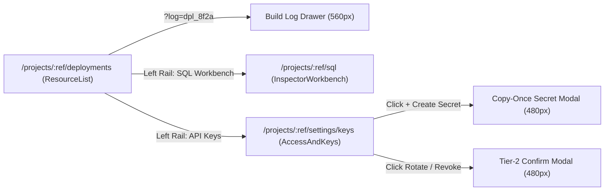

# UX.md: Cloud Infrastructure & Database Developer Workbench

## 0. Product & Domain Topology
- **Core value loop:** Developers manage cloud deployments and database tables in a project-scoped workbench (`/projects/:ref/...`), execute SQL or inspect build logs in a split workbench, and rotate API keys with explicit Tier-2 destructive safeguards.
- **Auth and role boundary:** Multi-Tenant Organization & Project RBAC (`Owner`, `Developer`, `ReadOnly`).
- **Platform profile:** `web-app` (`Pointer + Keyboard First` with monospace identifier copy ergonomics).

## 1. Spatial Architecture & App Shell

```text
+-----------------------------------------------------------------------------------+
| [Top Context Bar: 48px (Org Switcher / ProjectSwitch / Branch: main / Cmd+K)]     |
+-----------------------------------------------------------------------------------+
| [Left Rail: 220px]   | [Sticky PageHeader: 48px (Resource Title + Primary CTA)]   |
|                      +------------------------------------------------------------+
| - Deployments        |  Main Scrollable Canvas (scroll_owner: inner-canvas)       |
| - Table Editor       |  Padding: 24px Left / 24px Right (48px total outer)        |
| - SQL Workbench      |  Content Min-Width: 760px | Max-Width: 1280px              |
| - API Keys & Secrets |                                                            |
| [Status: Healthy]    |                                    [Inspector Slot: 560px] |
+-----------------------------------------------------------------------------------+
```

| Breakpoint | Fixed Chrome (`px`) | Outer Padding (`px`) | Available Content Width (`px`) | Collapse Action |
| :--- | :--- | :--- | :--- | :--- |
| `>= 1280px` (Desktop) | `220px` (Left Rail) | `48px` (`24px` x 2) | `1012px` (`>= 760px` min) | Persistent 220px left rail; Row/Deployment Inspector opens as `560px` right overlay drawer. |
| `768px to 1023px` (Tablet) | `0px` (Rail collapsed) | `32px` (`16px` x 2) | `736px to 991px` | Left Rail collapses into `260px` off-canvas sheet triggered by labeled `Menu` button in top bar. |
| `<= 767px` (Mobile) | `0px` (Bottom Bar `56px`) | `24px` (`12px` x 2) | `351px to 743px` | Resource tables stack into 3-field summary cards; SQL Workbench switches to vertical tabs (`[Query] | [Results]`). |

## 2. Scroll, Viewport & Z-Index Contract
- **Scroll ownership:** `inner-canvas` owns the vertical scrollbar for resource and key pages; `InspectorWorkbench` (`/sql`) splits `inner-canvas` into an upper editor pane and a lower results table pane with a draggable horizontal divider.
- **Sticky regions:** Global Top Context Bar (`48px`, `z-index: 20`) and `<PageHeader>` (`48px`, `z-index: 10`).
- **CLS protection:** Deployment cards reserve `72px` height; SQL result grids reserve `320px` height.

| Layer Name | Z-Index | Assigned Components |
| :--- | :--- | :--- |
| `base` | `0` | Deployment lists, schema grids, SQL editor pane |
| `sticky` | `10` | `<PageHeader>`, SQL execution toolbar, sticky table column headers |
| `navigation` | `20` | Top Org/Project Context Bar (`48px`), Left Rail (`220px`), mobile bottom bar (`56px`) |
| `drawer` | `30` | Row/Build-Log Inspector Drawer (`560px`), Schema Docs Drawer (`480px`) |
| `modal` | `40` | Copy-Once Secret Reveal Modal (`480px`), Tier-2 Resource Destruction Modal (`480px`) |
| `popover` | `50` | Org/Project/Branch switcher comboboxes, environment filter menu |
| `toast` | `60` | Deployment rollback and background migration completion toasts (`4000ms`) |
| `tooltip` | `70` | Commit SHA, full ISO timestamp, and keyboard shortcut tooltips |

## 3. Core Page Archetypes (Blueprints)

### Archetype: ResourceList
- **Purpose and max-width:** Filterable list of deployments, branches, or database tables (`max-w: 1280px`).
- **Primary CTA position:** Top-right slot of `<PageHeader>` (`Trigger Deploy` or `+ New Table`).
```text
+--------------------------------------------------------------------+
| Deployments                                       [Trigger Deploy] |
+--------------------------------------------------------------------+
| [Search commit/branch...] [Env: All | Production | Preview]        |
+--------------------------------------------------------------------+
| dpl_8f2a  | main (a4c91e2) | Ready (34s) | 14m ago | [Inspect Log] |
+--------------------------------------------------------------------+
```

### Archetype: InspectorWorkbench
- **Purpose and max-width:** Split code/SQL editor and tabular output console (`max-w: 1280px`).
- **Primary CTA position:** Right side of workbench toolbar (`[Run Query (Cmd+Enter)]`).
```text
+--------------------------------------------------------------------+
| SQL Workbench                           [Saved Queries] [Run Query]|
+--------------------------------------------------------------------+
| 1 | SELECT id, email, created_at FROM users                        |
| 2 | WHERE status = 'active' ORDER BY created_at DESC LIMIT 50;     |
+--------------------------------------------------------------------+
| Results (50 rows in 18ms)                         [Export JSON/CSV]|
| id (uuid)            | email                 | created_at          |
+--------------------------------------------------------------------+
```

### Archetype: AccessAndKeys
- **Purpose and max-width:** High-security API key, webhook secret, and environment variable manager (`max-w: 960px`).
- **Primary CTA position:** Top-right slot of `<PageHeader>` (`+ Create Secret Key`).
```text
+--------------------------------------------------------------------+
| API Keys & Secrets                             [+ Create Secret]   |
+--------------------------------------------------------------------+
| Name          | Token Prefix     | Last Used | Actions             |
| Prod Backend  | sk_live_9f8a...  | 2m ago    | [Copy] [Rotate]     |
+--------------------------------------------------------------------+
```

## 4. Navigation, Route Graph & URL Persistence



| Route | Archetype | Entry Trigger | Primary Action | Exit / Cancel Fallback |
| :--- | :--- | :--- | :--- | :--- |
| `/projects/:ref/deployments` | `ResourceList` | Left Rail `Deployments` or Project Switcher | Inspect build logs (`?log=id`) or promote deployment | Switch project or filter environment |
| `/projects/:ref/sql` | `InspectorWorkbench` | Left Rail `SQL Workbench` or `Cmd+Shift+E` | Execute SQL query (`Cmd+Enter`) and inspect rows | Return to `/projects/:ref/deployments` |
| `/projects/:ref/settings/keys` | `AccessAndKeys` | Left Rail `API Keys & Secrets` | Create or rotate API secrets | Return to `/projects/:ref/deployments` |

### State persistence matrix (`F5` and Back-button contract)

| State Category | Storage Location | Parameter / Key Example | Reset Trigger |
| :--- | :--- | :--- | :--- |
| Environment & Search Filter | `URL Query` | `?env=production&q=a4c91e2` | Clicking `Clear filters` |
| Open Build Log / Row Drawer | `URL Query` | `?log=dpl_8f2a` | Pressing `Esc` or close button removes `?log=` |
| Active SQL Query Buffer | `LocalStorage` | `ux.sql_draft.<projectRef>` | Explicit `[Clear Editor]` click |
| Split Workbench Pane Ratio | `LocalStorage` | `ux.sql_split_ratio` | Double-clicking split divider resets to `50/50` |
| Newly Generated Secret Token | `Ephemeral Memory` | Copy-Once Modal memory state | Wiped permanently from client memory when modal closes |

## 5. Overlay & Feedback Decision Matrix

| Pattern | Trigger Condition & Field Limit | Dimensions | Dismiss & Dirty-State Behavior |
| :--- | :--- | :--- | :--- |
| `Slide-Over Drawer` | Streaming build logs (`?log=id`) or editing database row columns (`5 to 12` fields) | `width: 560px`, `100dvh` | `Esc` removes `?log=` param; intercepts close if database row form has `isDirty === true` |
| `Centered Modal` | Copy-once secret reveal (`<= 4` fields) or Tier-2 destructive confirmation | `max-w: 480px` | Secret reveal modal requires explicit `[I Have Saved This Key]` click before closing |
| `Inline Checkmark` | Clicking `[Copy]` on any commit SHA, UUID, connection string, or API key | Inline inside button (`2000ms` duration) | Swaps copy icon for checkmark for `2000ms` without firing a toast |
| `Auto-Dismiss Toast` | Deployment queued or background database migration completed | `width: 360px`, bottom-right | Auto-dismisses after `4000ms` |
| `Persistent Inline Error` | SQL execution syntax error, failed build step, or key rotation error | Inline inside results console or form banner | Never auto-dismisses; includes exact line/column number for SQL errors |

## 6. Mandatory View States (4-State Matrix)

| View / Component | `Loading` (Skeleton Geometry) | `Empty` (Copy + Primary CTA) | `Error` (Message + Retry Action) | `Populated` (Density & Overflow) |
| :--- | :--- | :--- | :--- | :--- |
| `/projects/:ref/deployments` (`ResourceList`) | 6 deployment card skeletons (`72px` height) matching ID, branch, status pill, and duration columns (`CLS = 0`) | Centered `420px` block: *"No deployments triggered for this project yet."* + `[Connect Git Repository]` CTA | Inline alert card with git provider error + `[Retry Sync]` button | `72px` rows, monospace commit SHAs, status badges (`Building`, `Ready`, `Failed`) |
| `/projects/:ref/sql` (`InspectorWorkbench`) | Editor shimmer block (`240px`) + 8 result table row skeletons (`36px` height) | Results pane initial state: *"Press Cmd+Enter to run query and view results."* + `[Load Sample Query]` CTA | Persistent SQL error panel in results pane showing Postgres error code, line number, and hint | Monospace result grid, `tabular-nums`, sticky headers, null cells rendered distinctly as `-` |
| `/projects/:ref/settings/keys` (`AccessAndKeys`) | 4 secret row skeletons (`56px` height) inside `960px` container | Centered `420px` block: *"No custom API keys created."* + `[+ Create Secret Key]` CTA | Inline error banner + `[Reload Keys]` button | Masked prefix (`sk_live_9f8a...`), `tabular-nums` last-used date, `[Copy]` and `[Rotate]` actions |

## 7. Mutation, Form & Permission Ergonomics
- **Validation timing:** Validate resource names and environment variable keys on `blur` and `submit` (for example enforcing `^[A-Z0-9_]+$` on env var keys with immediate feedback).
- **Submit locking:** `[Run Query]`, `[Trigger Deploy]`, and `[Rotate Key]` lock (`disabled + aria-busy="true"`) during flight while keeping button width constant.
- **Dirty-state guard (`isDirty`):** Unsaved SQL queries persist automatically to `localStorage` (`ux.sql_draft.<projectRef>`). Editing environment variables or table rows blocks drawer closure when `isDirty === true`.
- **Destructive action tiers:**
  - **Tier 1 (cancel queued preview build):** Instant execution + `4000ms` Toast with `[Re-queue]`.
  - **Tier 2 (drop database table, revoke production API key, delete project):** `480px` Confirmation Modal requiring the user to type the exact resource slug (`project-ref` or table name) to enable the destructive submit button.
- **Permission and entitlement gates:**
  - **Role-restricted (`ReadOnly` vs `Owner`):** Hide `[+ Create Secret Key]` and `[Rotate]` controls completely for `ReadOnly` members.
  - **Prerequisite-restricted (confirmation slug mismatch):** Keep Tier-2 destructive button `disabled` until typed text matches the target resource name.
  - **Plan-restricted (Point-in-Time Recovery):** Render feature card with `Pro` lock badge and inline upgrade popover.

## 8. Real-Data Stress, Density & Truncation
- **Collection scaling:** Cursor-based pagination (`50 rows/page`) for deployment lists and SQL result sets.
- **Text overflow rules:** Commit messages and connection strings enforce `min-w-0 truncate` (1 line); build logs inside the `560px` drawer use virtualized monospace lines with horizontal scroll (`overflow-x-auto`) and an optional `[Wrap Lines]` toggle.
- **Missing or null data fallback:** SQL `NULL` values and unused key timestamps render `-` in muted monospace styling.
- **Numeric and temporal alignment:** Build durations (`34s`), row counts, byte sizes (`MB`), and timestamps enforce `font-variant-numeric: tabular-nums`.

## 9. Responsive Reflow & Input Choreography
- **Breakpoint collapse sequence:**
  1. `< 1280px`: `560px` Build Log Drawer overlays the main canvas (`z-30`).
  2. `< 1024px`: `220px` Left Rail collapses into an off-canvas sheet (`260px`) opened via a labeled `Menu` button in the Top Context Bar.
  3. `< 768px`: Deployment and API key tables collapse into stacked cards; `/projects/:ref/sql` switches from vertical split to segmented tabs (`[Query Editor] | [Results (50)]`); touch targets enforce `>= 44x44px` with `>= 8px` spacing.
- **Hover parity on touch:** Commit SHA and key action buttons (`Copy`, `Inspect Log`) remain visible on mobile cards without requiring pointer hover.
- **Keyboard and focus choreography:**
  - `Cmd/Ctrl+Enter` runs the active SQL query; `Cmd/Ctrl+K` opens the project/resource command palette; `Esc` closes the Build Log Drawer and returns focus to the deployment row.

## 10. Mandatory Layout Primitives (Code Contract)

| Primitive | Required Usage | Forbidden Bypass |
| :--- | :--- | :--- |
| `<AppShell>` | Renders `48px` Top Context Bar, `220px` Left Rail, and `inner-canvas` container. | Duplicating project switchers or nesting full-page scrollbars inside routes. |
| `<PageHeader>` | Renders resource title, status badge, and top-right primary CTA (`Trigger Deploy`, `+ Create Secret`). | Placing primary creation buttons below tables or inside unaligned toolbars. |
| `<PageSection>` | Enforces `max-w: 1280px` (`ResourceList`, `InspectorWorkbench`) or `max-w: 960px` (`AccessAndKeys`). | Using arbitrary container widths across settings and resource pages. |
| `<DataStateBoundary>` | Wraps deployment lists, SQL result grids, and key tables with geometry-matched skeletons. | Rendering raw stack traces or blank panels when a query or fetch fails. |

## 11. Project Do's, Don'ts & Agent Prompt Guide

### Do's and Don'ts (threshold rules)
- **DO** use a `2000ms` inline checkmark swap on `[Copy]` buttons for UUIDs, SHAs, and API keys instead of firing toast notifications.
- **DO** require typing the exact resource name inside a `480px` Tier-2 Confirmation Modal before dropping a database table, deleting a project, or revoking a production API key.
- **DO** auto-save the SQL Workbench editor buffer to `localStorage` (`ux.sql_draft.<projectRef>`) so a browser refresh (`F5`) never loses a query.
- **DO** display newly generated secret keys inside a Copy-Once Modal that clears the plaintext value from memory on close.
- **DO** keep `?env=` and `?log=<deploymentId>` synchronized in the URL query string.
- **DON'T** display plaintext production secret keys directly inside table rows after initial creation (only show masked prefixes like `sk_live_9f8a...`).
- **DON'T** auto-dismiss SQL syntax error messages or failed deployment logs.
- **DON'T** render literal `undefined` or `NaN` in telemetry or query cells (always use `-`).
- **DON'T** allow closing a database row editor drawer via backdrop click when `isDirty === true`.
- **DON'T** place interactive icon controls closer than `8px` or smaller than `44x44px` on touch viewports.

### Pre-commit agent checklist
1. Does the route compose `<AppShell>`, `<PageHeader>`, `<PageSection>`, and `<DataStateBoundary>`?
2. Are destructive infrastructure mutations protected by a Tier-2 slug-confirmation modal?
3. Do `[Copy]` actions use `2000ms` inline checkmark feedback rather than toast spam?
4. Do `?env=` and `?log=` parameters survive `F5` refresh and Browser `Back`?
5. Does `node .agents/skills/ux-md-generator/scripts/validate-ux.mjs UX.md` pass with `0 errors`?
