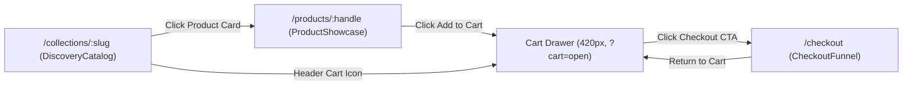

# UX.md: High-Conversion E-Commerce Storefront & Cart Funnel

## 0. Product & Domain Topology
- **Core value loop:** Shoppers browse faceted product catalogs (`/collections/:slug`), configure variants on product showcase pages (`/products/:handle`), inspect their order in a non-blocking slide-over Cart Drawer (`?cart=open`), and complete purchase in a distraction-free single-column checkout (`/checkout`).
- **Auth and role boundary:** Public guest browsing and guest checkout by default; optional authenticated customer account history (`/account/orders`).
- **Platform profile:** `web-app` (`window` document scroll with sticky `64px` top header and touch-first mobile ergonomics).

## 1. Spatial Architecture & App Shell

```text
+-----------------------------------------------------------------------------------+
| [Sticky Storefront Header: 64px (Categories | Search Trigger | Cart Badge (2))]   |
+-----------------------------------------------------------------------------------+
| [Facet Sidebar: 240px] | [PageHeader: Collection Title + Sort Combobox]           |
| (Collections only)     +----------------------------------------------------------+
| - Category             |  Main Document Canvas (scroll_owner: window)             |
| - Size                 |  Max-Width: 1280px | Outer Padding: 48px (24px x 2)      |
| - Color                |  Product Card Grid: 3 cols Desktop / 2 Tablet / 2 Mobile |
| - Price Range          |                                                          |
|                        |                                      [Cart Drawer: 420px]|
+-----------------------------------------------------------------------------------+
```

| Breakpoint | Fixed Chrome (`px`) | Outer Padding (`px`) | Available Content Width (`px`) | Collapse Action |
| :--- | :--- | :--- | :--- | :--- |
| `>= 1280px` (Desktop) | `240px` (Facet Sidebar on catalog) | `48px` (`24px` x 2) | `992px` (`>= 760px` min) | Persistent 240px facet sidebar on `/collections/:slug`; 3-column product card grid (`24px` gap). |
| `768px to 1023px` (Tablet) | `0px` (Facets in sheet) | `32px` (`16px` x 2) | `736px to 991px` | Facet sidebar collapses into a slide-over Filter Drawer (`340px`) triggered by `[Filter & Sort (2)]` button. |
| `<= 767px` (Mobile) | `0px` | `24px` (`12px` x 2) | `351px to 743px` | 2-column compact product card grid (`12px` gap); sticky bottom `[Add to Cart]` bar (`64px` + safe-area) on product pages. |

## 2. Scroll, Viewport & Z-Index Contract
- **Scroll ownership:** `window` owns vertical document scrolling so browser mobile address bars auto-collapse naturally. When the Cart Drawer (`420px`) or Filter Sheet is open, `document.body` scroll is locked.
- **Sticky regions:** Top Storefront Header (`64px`, `z-index: 20`), catalog active-filter toolbar (`48px`, `z-index: 10`), and desktop Product Purchase Box (`position: sticky; top: 88px`).
- **CLS protection:** All product media containers enforce a strict `aspect-ratio: 4 / 5` reservation before images load.

| Layer Name | Z-Index | Assigned Components |
| :--- | :--- | :--- |
| `base` | `0` | Product card grids, media galleries, review lists |
| `sticky` | `10` | Catalog filter/sort bar, desktop sticky buy box, mobile sticky `[Add to Cart]` bar |
| `navigation` | `20` | Sticky `64px` top header, announcement bar |
| `drawer` | `30` | Right Slide-Over Cart Drawer (`420px`), mobile Filter & Category Sheet |
| `modal` | `40` | Size guide modal (`480px`), quick-search modal (`600px`) |
| `popover` | `50` | Sort order dropdown, currency/country selector |
| `toast` | `60` | Item removed from cart `[Undo]` toast (`4000ms`) |
| `tooltip` | `70` | Swatch color names and shipping cutoff tooltips |

## 3. Core Page Archetypes (Blueprints)

### Archetype: DiscoveryCatalog
- **Purpose and max-width:** Faceted collection grid and search results view (`max-w: 1280px`).
- **Primary CTA position:** Top-right sort/filter controls in `<PageHeader>`; card click navigates to `/products/:handle`.
```text
+--------------------------------------------------------------------+
| Outerwear Collection (48 items)             [Filter] [Sort: Newest]|
+----------------------+---------------------------------------------+
| Facets (240px)       | Product Grid (3 columns, aspect 4:5 media)  |
| [x] Waterproof       | +------------+ +------------+ +-----------+ |
| [ ] Insulated        | | Image 4:5  | | Image 4:5  | | Image 4:5 | |
| Size: [S] [M] [L]    | | Shell Parka| | Down Vest  | | Rain Coat | |
| [Clear All (1)]      | | $240.00    | | $165.00    | | $190.00   | |
|                      | +------------+ +------------+ +-----------+ |
+----------------------+---------------------------------------------+
```

### Archetype: ProductShowcase
- **Purpose and max-width:** 2-column product configuration and storytelling view (`max-w: 1280px`).
- **Primary CTA position:** Sticky right purchase column `[Add to Cart - $240.00]` (`>= 48px` height).
```text
+--------------------------------------------------------------------+
| Home / Outerwear / Alpine Shell Parka                              |
+--------------------------------------+-----------------------------+
| Media Gallery (55% width)            | Sticky Buy Box (45% width)  |
| +----------------------------------+ | Alpine Shell Parka  $240.00 |
| | Primary Product Image (4:5)      | | Color: [Obsidian] [Clay]    |
| |                                  | | Size:  [S] [M] [L] [XL]     |
| +----------------------------------+ | [   Add to Cart - $240.00 ] |
| [Thumb 1] [Thumb 2] [Thumb 3]        | - Free 30-day returns       |
+--------------------------------------+-----------------------------+
```

### Archetype: CheckoutFunnel
- **Purpose and max-width:** Distraction-free checkout flow (`max-w: 1024px`, 2-column split: `560px` form column + `380px` sticky order summary; top navigation links hidden).
- **Primary CTA position:** Bottom of active checkout step (`[Continue to Shipping]` / `[Pay $240.00]`).
```text
+--------------------------------------------------------------------+
| [Store Logo]                                    [Return to Cart]   |
+------------------------------------+-------------------------------+
| Checkout Form (560px)              | Sticky Order Summary (380px)  |
| 1. Contact & Shipping Address      | - Alpine Shell Parka (M) $240 |
| [Email                           ] | - Shipping               Free |
| [Street Address                  ] | - Estimated Tax        $19.20 |
| [  Pay $259.20                   ] | Total                 $259.20 |
+------------------------------------+-------------------------------+
```

## 4. Navigation, Route Graph & URL Persistence



| Route | Archetype | Entry Trigger | Primary Action | Exit / Cancel Fallback |
| :--- | :--- | :--- | :--- | :--- |
| `/collections/:slug` | `DiscoveryCatalog` | Top header category links or search query | Filter products and select a product card | Clear filters or navigate to `/collections/all` |
| `/products/:handle` | `ProductShowcase` | Product card click in catalog or cart drawer | Select variant (`?variant=id`) and click `[Add to Cart]` | Breadcrumb return to `/collections/:slug` preserving facet query |
| `/checkout` | `CheckoutFunnel` | `[Proceed to Checkout]` inside Cart Drawer | Submit shipping and payment to complete order | `[Return to Cart]` link reopens `/collections/all?cart=open` |
| `/account/orders` | `DiscoveryCatalog` | Header account icon | Inspect order status and tracking link | Return to `/collections/all` |

### State persistence matrix (`F5` and Back-button contract)

| State Category | Storage Location | Parameter / Key Example | Reset Trigger |
| :--- | :--- | :--- | :--- |
| Catalog Facets, Sort & Page | `URL Query` | `?size=m,l&color=obsidian&sort=price_asc&page=2` | Clicking `[Clear All Filters]` |
| Selected Product Variant | `URL Query` | `?variant=40912` | Selecting a different size or color swatch updates `?variant=` |
| Open Cart Drawer State | `URL Query` | `?cart=open` | Pressing `Esc` or backdrop click removes `?cart=open` |
| Shopping Cart Line Items | `LocalStorage` | `ux.cart_session_id` (synced with server cart token) | Order completion or manual cart clear |
| Checkout Address Inputs | `LocalStorage` | `ux.checkout_draft` | Cleared upon order confirmation |

## 5. Overlay & Feedback Decision Matrix

| Pattern | Trigger Condition & Field Limit | Dimensions | Dismiss & Dirty-State Behavior |
| :--- | :--- | :--- | :--- |
| `Slide-Over Cart Drawer` | Clicking `[Add to Cart]` or header cart icon (`?cart=open`) | `width: 420px`, `100dvh` | Closes via `Esc`, close button, or backdrop click; updates line-item quantities optimistically |
| `Centered Modal` | Viewing static Size Guide table or Storefront Search (`<= 4` controls) | `max-w: 480px` (`600px` for search) | Closes immediately on `Esc` or backdrop click |
| `Dedicated Route` | Multi-field Checkout flow (`/checkout`) and full Product page (`/products/:handle`) | `max-w: 1024px` / `1280px` | Preserves checkout inputs in `ux.checkout_draft` if user navigates back |
| `Auto-Dismiss Toast` | Line item removed from Cart Drawer with `[Undo]` action | `width: 340px`, bottom-right | Auto-dismisses after `4000ms` |
| `Inline Validation Alert` | Out-of-stock variant selection, invalid promo code, or payment decline | Inline directly above CTA or under input field | Persistent (never auto-dismisses); clears immediately when input changes |

## 6. Mandatory View States (4-State Matrix)

| View / Component | `Loading` (Skeleton Geometry) | `Empty` (Copy + Primary CTA) | `Error` (Message + Retry Action) | `Populated` (Density & Overflow) |
| :--- | :--- | :--- | :--- | :--- |
| `/collections/:slug` (`DiscoveryCatalog`) | 6 product card skeletons matching `4:5` image frame + 2 text lines (`20px` + `16px`, `CLS = 0`) | Centered `420px` block: *"No products match your selected filters."* + `[Reset All Filters]` CTA | Inline alert card inside grid area + `[Reload Collection]` button | 3-column desktop / 2-column mobile grid, `24 items/page`, title `line-clamp-1`, `tabular-nums` price |
| `/products/:handle` (`ProductShowcase`) | Left `4:5` gallery shimmer box + right buy-box skeleton (`36px` title, swatch pills, `48px` CTA block) | Out-of-stock variant state: CTA changes to `[Notify Me When Available]` opening a 1-field email inline capture | Persistent inline banner above `[Add to Cart]` if cart mutation fails + `[Try Again]` | High-res gallery with thumb strip, tactile swatch pills (`>= 44x44px`), sticky buy box |
| `/checkout` (`CheckoutFunnel`) | 2-column checkout skeleton (`560px` form blocks + `380px` order summary card) | If cart is empty on `/checkout` entry: *"Your cart is empty."* + `[Browse Best Sellers]` CTA | Persistent payment error alert box above `[Pay]` button retaining all typed address fields | Single-column progressive form sections + sticky itemized total with `tabular-nums` |
| `/account/orders` (`DiscoveryCatalog`) | 4 order card skeletons (`112px` height each) | Centered `420px` block: *"You have not placed any orders yet."* + `[Explore New Arrivals]` CTA | Inline alert card + `[Retry Fetch]` button | Order ID, date, status badge, item thumbnails, right-aligned total |

## 7. Mutation, Form & Permission Ergonomics
- **Variant selection and URL sync:** Clicking a color or size swatch immediately updates `?variant=<id>`, swaps the gallery image, and updates the price and stock state on `[Add to Cart]`.
- **Submit locking and optimistic cart updates:** Clicking `[Add to Cart]` shows an inline spinner for requests `>= 150ms` and opens the `420px` Cart Drawer once added. Quantity increments (`+` / `-`) inside the Cart Drawer update line totals optimistically and roll back with an inline message if inventory is exceeded.
- **Dirty-state guard (`isDirty`):** Typing shipping details in `/checkout` auto-saves non-sensitive address fields to `ux.checkout_draft` so an accidental reload never forces the shopper to retype their address.
- **Destructive action tiers:**
  - **Tier 1 (remove item from Cart Drawer):** Removes line item optimistically and displays a `4000ms` Toast with `[Undo]`.
  - **Tier 2 (cancel confirmed order in `/account/orders`):** Opens a `480px` Confirmation Modal stating refund timeline and permanent cancellation.
- **Permission and entitlement gates:**
  - **Guest vs. Authenticated:** Never block `/checkout` behind a mandatory account-creation wall; offer guest checkout first with an optional post-purchase password field.
  - **Prerequisite-restricted (no size selected):** Keep `[Select a Size]` button visually distinct; clicking scrolls smoothly to and highlights the size swatch row with an inline prompt (*"Please choose a size"*).

## 8. Real-Data Stress, Density & Truncation
- **Collection scaling:** Numbered page pagination (`24 products/page`) synced to `?page=` on `/collections/:slug` so footer links remain reachable and back-button scroll restoration works reliably.
- **Text overflow rules:** Product titles in catalog cards use `line-clamp-1`; product subtitles use `line-clamp-1`. Long variant names wrap cleanly inside flex-wrap pill groups (`gap: 8px`).
- **Missing or null data fallback:** Products without a compare-at discount price omit the strikethrough slot cleanly; missing optional specs in tables render `-`.
- **Numeric and temporal alignment:** Prices, discounts, quantities, and order totals enforce `font-variant-numeric: tabular-nums`.

## 9. Responsive Reflow & Input Choreography
- **Breakpoint collapse sequence:**
  1. `< 1024px`: `240px` Facet Sidebar on `/collections/:slug` collapses into a slide-over Filter Sheet triggered by a sticky `[Filter & Sort]` button.
  2. `< 768px`: Catalog grid displays 2 columns (`12px` gap); `/products/:handle` stacks the `4:5` image swipe carousel above the buy box and pins a sticky `[Add to Cart]` bar (`64px` + `env(safe-area-inset-bottom)`) at the bottom once the inline CTA scrolls out of view.
  3. `< 768px` on `/checkout`: The `380px` Order Summary collapses into an expandable top accordion (`[Show Order Summary - $259.20]`) above the `560px` shipping form.
- **Touch targets and hover parity:** All size/color swatches and cart quantity `+`/`-` buttons enforce `>= 44x44px` hit areas with `>= 8px` gap. Secondary product images that reveal on hover on desktop are accessible via horizontal swipe dots on touch devices.
- **Keyboard and focus choreography:**
  - `Esc` closes the Cart Drawer, Filter Sheet, or Size Guide Modal and returns focus to the trigger button.

## 10. Mandatory Layout Primitives (Code Contract)

| Primitive | Required Usage | Forbidden Bypass |
| :--- | :--- | :--- |
| `<AppShell>` | Renders sticky `64px` header (or distraction-free `/checkout` header), Cart Drawer slot, and `window` scroll landmarks. | Rendering full navigation bars inside `/checkout` or locking `100vh` scroll on catalog pages. |
| `<PageHeader>` | Collection title, item count badge, and active facet/sort controls. | Inconsistent title placement across collection and account pages. |
| `<PageSection>` | Enforces `max-w: 1280px` (`DiscoveryCatalog`, `ProductShowcase`) or `max-w: 1024px` (`CheckoutFunnel`). | Unbounded fluid grids stretching beyond `1280px` or missing outer padding on mobile. |
| `<DataStateBoundary>` | Wraps catalog grids, product buy boxes, and cart drawer contents with `4:5` aspect-reserved skeletons. | Loading product images without aspect-ratio boxes (`CLS > 0`) or dropping cart state on error. |

## 11. Project Do's, Don'ts & Agent Prompt Guide

### Do's and Don'ts (threshold rules)
- **DO** reserve `aspect-ratio: 4 / 5` on every product image and skeleton card so `CLS` equals `0`.
- **DO** synchronize active catalog facets (`?size=&color=&sort=&page=`) and selected product variants (`?variant=id`) in the URL query string.
- **DO** open the `420px` Slide-Over Cart Drawer (`?cart=open`) when `[Add to Cart]` succeeds instead of forcing a full-page redirect to `/cart`.
- **DO** use numbered pagination (`24 items/page`) on `/collections/:slug` so users can reach the page footer and return to exact scroll positions via Browser `Back`.
- **DO** enforce `>= 44x44px` tap targets with `>= 8px` spacing on all size/color swatches and quantity steppers.
- **DON'T** use infinite scroll on e-commerce collection pages that have a global site footer.
- **DON'T** gate `/checkout` behind a mandatory login or signup modal.
- **DON'T** show main category navigation or promotional popups inside `/checkout` (`CheckoutFunnel`).
- **DON'T** wipe typed shipping address fields when a promo code or payment attempt fails.
- **DON'T** render `null`, `undefined`, or `$NaN` when variant pricing is loading.

### Pre-commit agent checklist
1. Does the view compose `<AppShell>`, `<PageHeader>`, `<PageSection>`, and `<DataStateBoundary>`?
2. Do all product images and loading skeletons reserve a `4:5` aspect ratio (`CLS = 0`)?
3. Are catalog filters, pagination (`?page=`), selected variants (`?variant=`), and Cart Drawer state (`?cart=open`) synced to the URL?
4. Do all swatches and quantity buttons meet `>= 44x44px` with `>= 8px` spacing?
5. Does `node .agents/skills/ux-md-generator/scripts/validate-ux.mjs UX.md` pass with `0 errors`?
